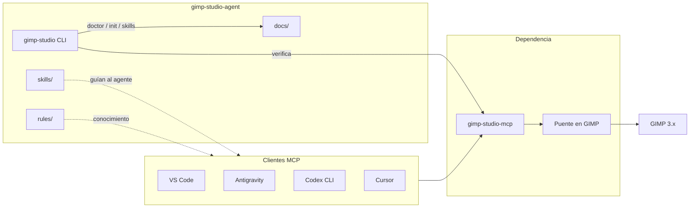

# Contexto del proyecto: gimp-studio-agent

Documento de trabajo para llevar a cabo el complemento sobre [gimp-studio-mcp](https://github.com/TwelveTake-Studios/gimp-studio-mcp). Resume decisiones, alcance, arquitectura y próximos pasos acordados en conversación (octubre 2026).

## 1. Objetivo

Permitir que un agente de IA, desde un IDE o un CLI, reciba instrucciones en **lenguaje natural** y sepa **qué hacer** en GIMP: no solo qué herramientas MCP existen, sino el flujo (abrir → editar → revisar → exportar), buenas prácticas y, cuando aplique, producción DTF/impresión.

El agente no debe improvisar Python dentro de GIMP para tareas cotidianas: usa las herramientas estructuradas del MCP y se guía por skills y reglas de oficio.

## 2. Por qué GIMP y por qué este MCP

| Criterio | Decisión |
|----------|----------|
| App | **GIMP 3.x** — gratis, Linux, API Python, comparable en capacidad técnica a Photoshop para edición. |
| MCP base | **[TwelveTake-Studios/gimp-studio-mcp](https://github.com/TwelveTake-Studios/gimp-studio-mcp)** (`twelvetake-gimp-studio-mcp` en PyPI) — MIT, ~119 herramientas, headless y live, orientado a print/DTF, listado en el MCP Registry. |
| Alternativas vistas | `maorcc/gimp-mcp` (GPL-3.0, GIMP abierto), `Hackerobi/gimp-mcp-pro` (MIT, atado a GIMP 3.0.8). Se eligió gimp-studio-mcp por cantidad de herramientas y diseño de producción. |

Requisitos del MCP base (no los reinventamos):

1. Instalar el servidor: `pipx install twelvetake-gimp-studio-mcp` (o `pip install -e .` desde el repo).
2. Instalar el puente en GIMP: `gimp-mcp install-plugin` y reiniciar GIMP.
3. Verificar: `gimp-mcp doctor`.
4. Registrar en el cliente MCP: comando `gimp-mcp` con args `["serve"]`.

> [!IMPORTANT]
> El “plugin” del README upstream es el **puente dentro de GIMP**, no una extensión de VS Code / Antigravity / Codex. Esos clientes solo necesitan la entrada MCP stdio.

## 3. Decisión de arquitectura: complemento, no fork

### Qué se acordó

| Opción | Veredicto |
|--------|-----------|
| Fork de gimp-studio-mcp con skills y docs dentro | **No** como camino principal. Obliga a sincronizar con upstream (herramientas, bugs, compatibilidad GIMP). |
| Paquete **complemento** que declara el MCP como dependencia | **Sí.** Docs multi-cliente, skills, rules y CLI viven aquí. |
| Fork más adelante | Solo si hace falta **cambiar el código del servidor** (herramientas, protocolo, bridge). La licencia MIT lo permite. |

### Analogía de referencia

[with-pebbly/aseprite-ai-artist](https://github.com/with-pebbly/aseprite-ai-artist) combina MCP + skills por etapa + base de reglas de oficio, y deja pocas herramientas agrupadas a propósito (coste de contexto). Nuestro caso es distinto en un punto: **el MCP ya existe**; nosotros aportamos la capa de agente (skills + docs + CLI), no un segundo servidor.

Otros MCP de Aseprite (`diivi/aseprite-mcp`, etc.) confirman que el ecosistema MCP + pixel/creative tools es maduro; el patrón “skills encima del MCP” es el que replicamos para GIMP.

### Diagrama



## 4. Alcance de este repositorio

### Incluye

- Documentación de instalación del MCP en **VS Code**, **Antigravity**, **Codex CLI**, **Cursor** (y guía base `install.md`).
- Paquete de **skills** por etapa, con `studio` como orquestador.
- **Rules** / buenas prácticas (capas, color, DTF, exportación, seguridad del `gimp_exec`).
- **CLI** `gimp-studio` para doctor, init de config MCP en el cliente elegido y apuntar al modo skills.
- Plantilla `mcp.example.json` portable.
- Dependencia explícita: `twelvetake-gimp-studio-mcp`.

### No incluye (por ahora)

- Fork ni parches al código del servidor MCP.
- Reimplementar las 119 herramientas.
- Empaquetar GIMP ni sustituir `gimp-mcp install-plugin`.
- Generación de imágenes con modelos externos (el flujo es edición controlada en GIMP).

## 5. Estructura de carpetas

```
gimp-studio-agent/
├── README.md                 # Visión corta + enlace a este CONTEXTO
├── CONTEXTO.md               # Este documento
├── pyproject.toml            # deps + entry point gimp-studio
├── mcp.example.json
├── docs/
│   ├── install.md            # PyPI, bridge, doctor
│   ├── vscode.md
│   ├── antigravity.md
│   ├── codex.md
│   └── cursor.md
├── skills/
│   ├── studio/SKILL.md       # Planifica y encadena el resto
│   ├── open/SKILL.md
│   ├── edit/SKILL.md
│   ├── dtf/SKILL.md
│   ├── review/SKILL.md
│   └── export/SKILL.md
├── rules/                    # Oficio y checklists
├── src/gimp_studio/
│   ├── __init__.py
│   └── cli.py
└── examples/prompts.md
```

Los `SKILL.md` y docs empiezan como placeholders; el contenido se rellena en fases (ver §8).

## 6. Skills: contrato mínimo

Cada skill debe:

1. Declarar que **requiere** el servidor MCP `gimp` (gimp-studio-mcp) activo.
2. Describir en lenguaje natural **cuándo** usarlo y **pasos** preferidos (qué herramientas MCP llamar, en qué orden).
3. Indicar verificaciones (`get_bitmap`, checkpoints, doctor) antes de operaciones destructivas.
4. Remitir a `rules/` para detalle de oficio; no duplicar catálogos enormes de herramientas (el cliente MCP ya las describe).

| Skill | Rol |
|-------|-----|
| `studio` | Entrada única: interpreta el brief, elige skills, no salta revisión ni export. |
| `open` | Abrir/crear documento, metadatos, capas iniciales. |
| `edit` | Pintura, selección, texto, color/tono, filtros cotidianos. |
| `dtf` | Knockout, underbase, choke, gang sheet, PNG DTF a DPI. |
| `review` | Inspección visual, histogramas, checklist de calidad. |
| `export` | Exportación segura (alfa, perfil ICC, formatos). |

Inspiración de naming/flujo: skills tipo `studio` / `review` / `export` de aseprite-ai-artist, adaptados a GIMP y DTF.

## 7. CLI propuesto

Comando: `gimp-studio` (entry point en `pyproject.toml`).

| Subcomando | Comportamiento esperado |
|------------|-------------------------|
| `doctor` | Comprueba `gimp-mcp` en PATH, sugiere `gimp-mcp doctor`, avisa si falta el bridge. |
| `init` | Copia o fusiona `mcp.example.json` en la ruta del cliente (`--client vscode|antigravity|codex|cursor`). |
| `skills` | Lista skills y rutas; opcionalmente imprime el contenido de `studio` para pegar en el agente. |
| *(default)* | Ayuda breve + enlace a `docs/install.md`. |

No lanza el modelo por sí solo: prepara el entorno para que el IDE/CLI del usuario use el MCP + skills.

## 8. Clientes MCP (cómo se conectan)

Todos usan el **mismo** servidor stdio; solo cambia el archivo de config.

```json
{
  "mcpServers": {
    "gimp": {
      "command": "gimp-mcp",
      "args": ["serve"]
    }
  }
}
```

| Cliente | Dónde configurar (orientativo) |
|---------|--------------------------------|
| VS Code | `.mcp.json` (portable) o config MCP del perfil / Copilot |
| Antigravity | MCP Store o `mcp_config.json` (p. ej. `~/.gemini/config/` o `.agents/`) |
| Codex CLI | `codex mcp add gimp -- gimp-mcp serve` → `~/.codex/config.toml` |
| Cursor | `.cursor/mcp.json` / config MCP del proyecto |

Variables útiles del upstream (documentar en `docs/install.md`): `GIMP_MCP_HEADLESS`, `GIMP_MCP_NO_EXEC`, etc.

## 9. Seguridad (heredar del upstream)

- El MCP corre con la misma confianza que el usuario local.
- `gimp_exec` ejecuta Python arbitrario en el proceso de GIMP; desactivar con `GIMP_MCP_NO_EXEC=1` si no hace falta.
- Bridge en loopback + token; no exponer a red.
- Skills deben preferir herramientas estructuradas y solo usar `gimp_exec` como escape hatch documentado.

## 10. Relación con otros hilos del usuario

Contexto de producto (no bloquea este repo, pero explica el “por qué”):

- Video de divulgación / phishing y bot **Editor de Video** (Kdenlive): línea de edición de video, separada de este complemento de **imagen**.
- Investigación previa de MCPs GIMP y comparación con Blender-like plugins: originó la elección de gimp-studio-mcp + capa de skills.

## 11. Plan de ejecución (fases)

- [ ] **Fase 0** — Esqueleto de carpetas y este `CONTEXTO.md` *(hecho)*.
- [ ] **Fase 1** — Rellenar `docs/install.md` + un cliente (p. ej. `docs/codex.md` o `docs/vscode.md`) con pasos verificables.
- [ ] **Fase 2** — Skill `studio` completo (brief → plan → llamadas MCP → review → export).
- [ ] **Fase 3** — Skills `open`, `edit`, `review`, `export` con checklists.
- [ ] **Fase 4** — Skill `dtf` alineado a herramientas print/DTF del MCP.
- [ ] **Fase 5** — `rules/` (oficio + seguridad) y `examples/prompts.md`.
- [ ] **Fase 6** — CLI `doctor` + `init` mínimos.
- [ ] **Fase 7** — README público, versión 0.1.0, publicar o dejar como repo privado según se decida.

Criterio de “listo para usar”: un agente en Codex o VS Code, con el MCP registrado, puede seguir `studio` y completar un brief simple (abrir → ajuste → export PNG) sin inventar scripts.

## 12. Criterios de diseño (recordatorios)

1. **No fork** del servidor salvo necesidad de código.
2. **Pocas skills profundas** mejor que cientos de micro-instrucciones.
3. **El MCP describe herramientas**; nosotros describimos **juicio y flujo**.
4. **Docs por cliente** sin duplicar la lista de 119 tools.
5. **DTF/print** como ventaja diferencial donde el MCP ya brilla.
6. **Idioma**: documentación y skills en **español** salvo que se decida bilingüe más adelante.
7. **MIT** alineado con el MCP base; respetar atribución y no redistribuir GIMP.

## 13. Enlaces clave

- MCP base: [TwelveTake-Studios/gimp-studio-mcp](https://github.com/TwelveTake-Studios/gimp-studio-mcp)
- PyPI: [twelvetake-gimp-studio-mcp](https://pypi.org/project/twelvetake-gimp-studio-mcp/)
- Referencia de patrón skills+MCP: [with-pebbly/aseprite-ai-artist](https://github.com/with-pebbly/aseprite-ai-artist)
- Docs VS Code MCP: [Add MCP servers in VS Code](https://code.visualstudio.com/docs/agent-customization/mcp-servers/)
- Antigravity MCP: [MCP in Antigravity IDE](https://www.antigravity.google/docs/ide/mcp/)
- Codex MCP: configuración vía `codex mcp add` / `~/.codex/config.toml`

## 14. Glosario breve

| Término | Significado aquí |
|---------|------------------|
| MCP | Model Context Protocol: el cliente habla con un servidor de herramientas por stdio/HTTP. |
| Bridge / plugin GIMP | Extensión dentro de GIMP que el servidor MCP usa (live o headless). |
| Skill | Instrucciones reutilizables para el agente (cuándo y cómo actuar). |
| Complemento | Este repo: depende del MCP, no lo sustituye. |
| `studio` | Skill orquestador del flujo completo. |

---

*Última actualización: 2026-10-08. Autor del hilo de diseño: Jorge González con Grok Bot.*
